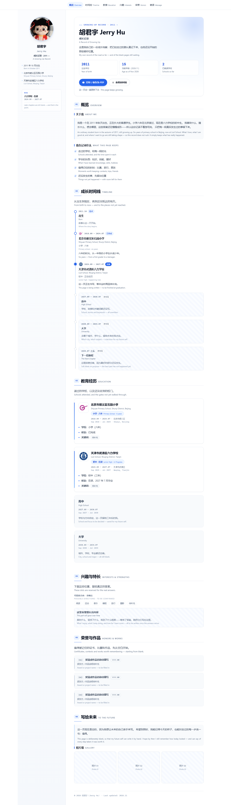

<h1 align="center">
胡君宇 Jerry Hu · 成长记录
</h1>

<p align="center">纯静态、零依赖的个人成长档案 · 专业编辑风 + 蓝色强调</p>

<p align="center">
    <br>
    
    <br>
</p>

在线预览：<https://yaohua0506.github.io/>

这个站点只做一件事：把已经走过的路记下来，并给还没开始的阶段留好位置。
页面只有 `index.html` + `style.css` 两个文件，不加载任何 CDN、字体或前端框架，断网双击也能正常打开。

## 现在记录了什么

| 时间 | 内容 | 状态 |
|---|---|---|
| 2011.10 | 出生 | 已发生 |
| 2018.09 – 2024.07 | 北京市顺义区石园小学 | 已完成 |
| 2024.09 – 2027.07 | 天津市武清区六力学校 | 在读 |
| 2027.09 – 2030.07 | 高中 | 留白，待书写 |
| 2030.09 – 2034.07 | 大学 | 留白，待书写 |
| 2034.07 之后 | 下一段旅程 | 留白，待书写 |

> 虚线框不是"没做完"，而是刻意留白：以后发生了，再回来补上。

## 主要特点

- **零依赖零请求**：图标是内联 SVG，字体用系统字体栈，没有任何外部资源请求。
- **成长时间线**：纵向时间轴区分「已完成 / 在读 / 待书写」三种状态，未来阶段用虚线占位。
- **滚动交互**：顶部阅读进度条、导航自动高亮、内容滚动淡入，并遵循 `prefers-reduced-motion` 自动降级。
- **响应式**：针对 375 / 768 / 1024 / 1440 四档调校；窄屏侧栏回落为顶部区块。
- **打印友好**：点「打印 / 保存为 PDF」或按 `Ctrl + P`，会隐藏导航与按钮、把虚线占位降为灰色，可直接存档。
- **可访问性**：语义化标签、`aria-label`、`focus-visible` 键盘焦点环、跳转到正文的 skip link。

## 页面结构

**布局**：

- **顶部导航**（吸顶，60px）：`概览 · 时间线 · 教育 · 兴趣 · 荣誉 · 寄语`，滚动时高亮当前区块
- **左侧栏**（宽 300px，`position: sticky; top: 60px`）：头像、中英文姓名、一句定位、三条身份信息、「现在」信息块
- **右侧栏**：内容区，随页面滚动
- 屏幕宽度小于 900px 时，侧栏回落成顶部区块，导航变成可横向滑动的一行

**正文**：

| 顺序 | 分区 | 锚点 | 格式说明 |
|---|---|---|---|
| 1 | 概览 Overview | `#about` | Hero 封面（姓名 / 简介 / 关键数字 / 打印按钮）+ 自我介绍引文 `.quote` + 勾选列表 `.checks` |
| 2 | 成长时间线 Timeline | `#timeline` | `.timeline` 纵向轴，每段一个 `.tl-item`，状态类 `is-done` / `is-now` / `is-pending` |
| 3 | 教育经历 Education | `#education` | `.exp` 卡片（学校 / 学段 / 时间 / 地点）+ 要点列表；未来学段用 `exp is-blank` |
| 4 | 兴趣与特长 Interests | `#interests` | 标签墙 `.tags`（`.is-blank` 表示待填）+ 待书写说明块 `.pending` |
| 5 | 荣誉与作品 Honors | `#honors` | `.awards` 列表，`[H1]` 编号 + 日期 + 说明 |
| 6 | 写给未来 Message | `#letter` | 引文 `.quote` + 照片墙占位 `.gallery` |

> 分区标题的 `01–06` 编号由 CSS 计数器自动生成，增删分区不用手改序号。

## 目录结构

```
.
├── index.html     页面结构 + 全部文字内容 + 底部内联脚本
├── style.css      设计令牌 + 组件样式 + 响应式 + 打印样式
├── images/
│   ├── avatar.jpg   头像（480×480）
│   ├── shiyuan.jpg  北京市顺义区石园小学校徽
│   └── liuli.jpg    天津市武清区六力学校校徽
├── screenshot.png README 配图
├── .nojekyll      告诉 GitHub Pages 不要用 Jekyll 处理
└── README.md      本文件
```

## 内容维护

正文唯一来源是 `index.html`，改文字时直接改对应区块即可：

| 要改的内容 | 在 index.html 里找 |
|---|---|
| 姓名 / 英文名 | Hero 的 `<h1 class="hero-name">`、侧栏 `.side-name` 与 `.side-en`（三处保持一致） |
| 左侧身份信息 | `<ul class="side-bio">` 与 `.side-note` |
| 关键数字 | Hero 内的 `<ul class="hero-stats">`（记得同步「当前年龄」） |
| 自我介绍 | `#about` 下的 `.hero-sub` 与 `.quote` |
| 时间线某一段 | `.timeline` 里的 `<li class="tl-item">` |
| 某所学校 | `<article class="exp">`，整块复制 / 修改 |
| 学校校徽 | `images/shiyuan.jpg`、`images/liuli.jpg`（时间线与教育卡片共用同一张图） |
| 头像 | `images/avatar.jpg`，详见「[换头像](#换头像)」 |
| 兴趣标签 | `.tags` 下的 `<li>`，去掉 `is-blank` 即变成正式内容 |
| 荣誉 / 作品 | `.awards` 里的 `<li class="is-blank">`，填好后删掉 `is-blank` |
| 照片 | `.gallery` 里把 `.pending` 占位换成 `` 即可 |
| 更新时间 | 页脚 `.footer` |

### 补上「高中」这一段

等到 2027 年，把时间线里的占位块换成正式条目：

```html
<li class="tl-item is-done">
  <div class="tl-top">
    <span class="tl-when">2027.09 — 2030.07</span>
    <span class="tl-tag">已完成</span>
  </div>
  <h3 class="tl-title">某某中学<span class="en">Some High School</span></h3>
  <p class="tl-sub">高中 · 三年<span class="en">High school · three years</span></p>
  <p class="tl-desc">在这里写这三年的故事。<span class="en">The story of these three years.</span></p>
</li>
```

教育经历区同理：把 `article class="exp is-blank"` 的 `is-blank` 去掉，再补上 `<ul class="bullets">` 里的学段、状态和关键词。

## 换校徽

两所学校的校徽都放在 `images/` 下，时间线与教育经历卡片引用的是同一份文件：

- `images/shiyuan.jpg` —— 石园小学校徽（横向）
- `images/liuli.jpg` —— 六力学校校徽（方形 / 圆形）

替换时保持文件名不变即可，两处会同时更新。图片会以 `object-fit: contain` 缩放：

- 教育经历卡片：64×64 白色圆角底块（窄屏 52×52）
- 成长时间线：28×28 迷你徽标（窄屏 24×24）

如果新校徽是透明背景的 PNG，直接覆盖同名文件后，再把 `index.html` 里对应 `` 的 `src` 后缀改成 `.png` 即可。
记得同步修改 `alt` 文本（如「北京市顺义区石园小学校徽」），方便读屏软件识别。

## 换头像

侧栏头像已经是真实图片（`images/avatar.jpg`，480×480 方形裁切，约 47 KB），显示为 148px 圆形，窄屏 112px。

替换时保持文件名不变即可，`index.html` 里对应的是：

```html

```

- 建议用**正方形**图片，或者主体位于画面中上部的竖图
- 圆形的焦点由 `style.css` 里的 `img.avatar { object-position: center 30%; }` 控制，换成其他照片时可以调成 `center`、`top` 等
- 建议先裁成 480×480 左右再上传，避免几 MB 的原图拖慢首屏
- 记得同步修改 `alt` 文本，说明头像内容

## 导出 PDF

顶部 Hero 里的「打印 / 保存为 PDF」按钮会调用 `window.print()`。在打印对话框里：

1. 目标选「另存为 PDF」；
2. 勾选「背景图形」可以保留淡淡的虚线底纹（不勾也完全可读）；
3. A4 纵向，页边距「默认」，即可得到分页正常的存档版。

`@media print` 会自动隐藏导航、侧栏头像和按钮，并把彩色强调降为深灰，方便黑白打印。

## 本地调试

1. 直接双击 `index.html`，改完存盘刷新即可，不需要构建步骤。
1. 想模拟手机效果，浏览器开发者工具里切到 375px / 768px 宽度查看。
1. 想检查打印效果，`Ctrl + P` 打开打印预览，确认时间线没有被拆断。

## 部署方式

- 仓库名必须是 `用户名.github.io`，且为 **Public**
- Settings → Pages → **Source 选 `Deploy from a branch`**，分支 `main`，目录 `/ (root)`
- 每次 `git push` 到 `main`，Pages 会自动重新构建，约 1 分钟生效

日常更新：

```powershell
git add -A
git commit -m "补充 2027 年高中阶段"
git push
```

## 已知占位

- 兴趣、荣誉、照片墙都是虚线占位，等内容确定后逐项替换
- 「15 岁」按 2026.11 计算，每年生日后需要手动更新；不想维护可以改成出生年份
